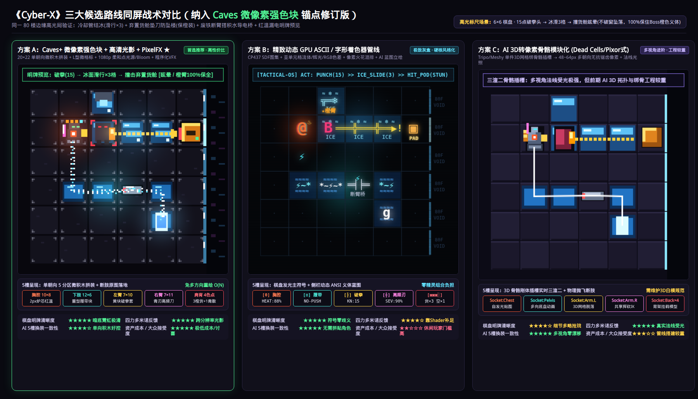
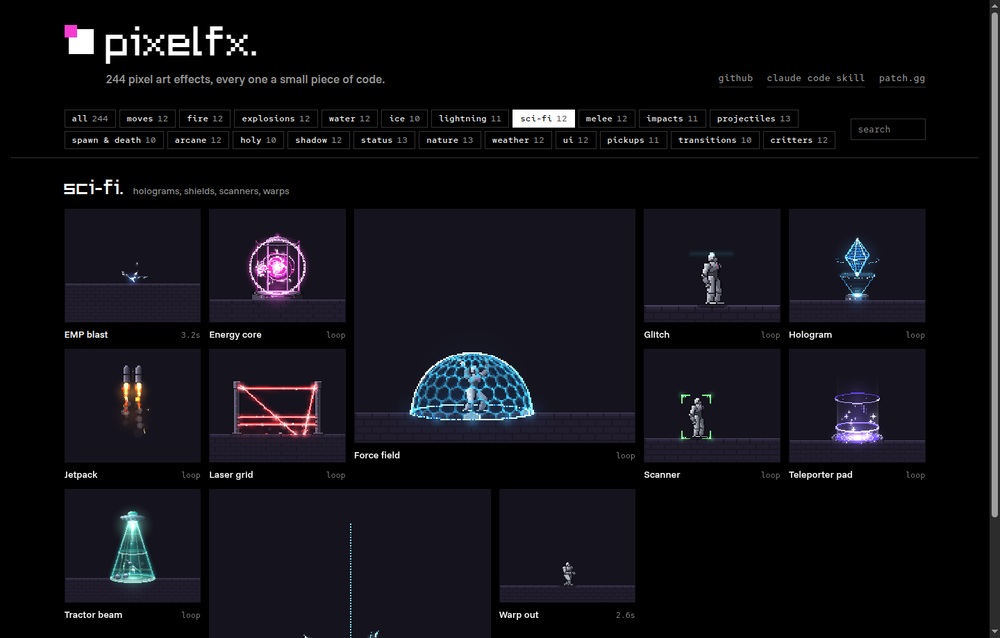
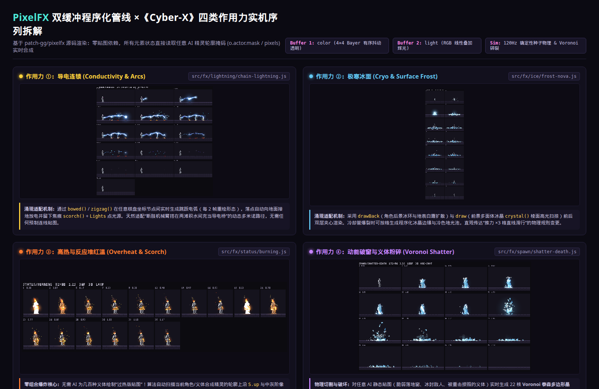
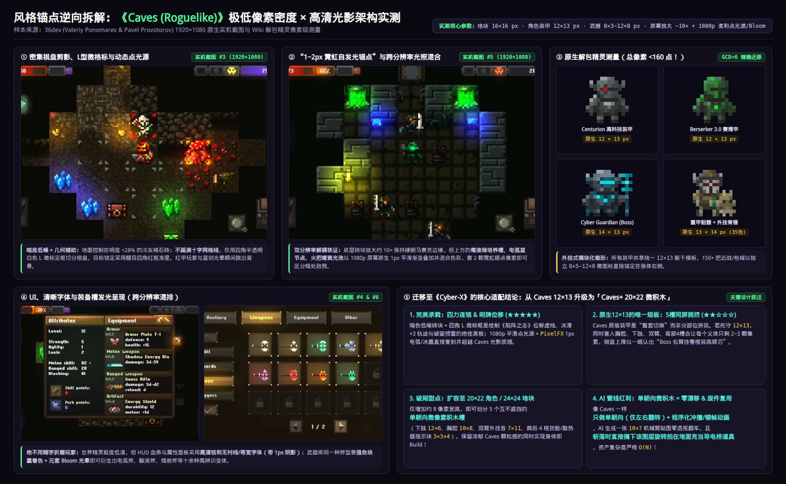

# 《Cyber-X》游戏美术风格与 AI 资产管线预研报告

> **研究定位**：面向“赛博朋克版《神界原罪2》环境涌现 × 《陷阵之志》明牌位移博弈 × 《Cogmind》5槽模块化义体 × 回合制搜打撤”核心体验，在**美术资产必须由 AI 主导生成**的硬约束下，深度拆解 `patch-gg/pixelfx` 程序化特效管线与 Laren 初步意向锚点《Caves (Roguelike)》的微像素光影架构，横向对比三大候选美术路线，给出原型期与量产期的可落地 AI 生产管线与技术架构决策。

---

## 一、核心结论先行（Executive Summary）

1. **调整后的首选主路线：「Caves+ 微像素强色块（20×22 角色 / 24×24 地块）+ 1080p 跨分辨率动态光影 + PixelFX 双缓冲程序化特效」**
   - 经对《Caves (Roguelike)》实机截图与解包精灵做像素级逆向测量，其“极低资产成本却极具辨识度与科技氛围”的底层秘密在于**跨分辨率解耦渲染**：底层采用 `16×16` 地块与 `12×13` 超低密度微像素强色块（仅左右翻转、无多方向透视动画），顶层叠加原生 1080p 平滑点光源、Bloom 辉光与高清锐利 UI 字体。
   - **关键微调（从 12×13 扩容至 20×22“Caves+ 甜点规格”）**：原版《Caves》装甲为整套切换（外挂一把 `8×3~12×8` 武器），若照搬 `12×13` 像素尺寸，无法在单格内清晰拆出《Cyber-X》的 **5 槽义体 Build 与敌方身上的橙装部位**。将单格微扩至 **`24×24` px（角色 `20×22` px）** 并保持**单朝向正视角（仅左右镜像）+ 5 分区微积木拼装（Kitbashing）**，即可彻底绕开 2D AI 多朝向换装的一致性灾难，让义体斩落后**直接复用同一张 `7×11` 微像素贴图旋转落地充当导电桥棋盘道具**，实现严格的 $O(N)$ 线性资产复杂度。
2. **PixelFX（`patch-gg/pixelfx`）对“四力涌现”的价值：把状态变异从 AI 出图彻底剥离给代码**
   - `pixelfx` 并非传统序列帧图库，而是一套 MIT 开源的**零贴图双缓冲（`color` 4×4 Bayer 抖动缓冲 + `light` 线性叠加辉光缓冲）+ 120Hz 确定性物理 + 轮廓感知（读取任意精灵 `mask/pixels`）程序化特效引擎**。
   - 在《Cyber-X》中，AI 只需负责生产“干净常态”的微像素义体积木、货舱与工业地块；**导电跳跃电弧、冷却管爆裂冰晶、反应堆红温火舌/焦痕、破窗/碎冰 Voronoi 刚体碎裂**全部由 Shader / 代码实时读取 AI 贴图轮廓动态合成，避免“N 件义体 × 4 种元素状态”的贴图组合爆炸。
3. **精致动态 GPU ASCII 路线的定位：最佳灰盒原型加速器 & 战术 HUD 视觉母语**
   - 通过 **SDF 字形着色器 + 亚单元格流体/热浪底色 + 多通道 Bloom/RGB 色差/CRT 扫描线 + 像素火花粒子混排**，现代 GPU ASCII 完全可以做到华丽且富有打击感，且拥有 **0 换装美术负担**。但它作为主画面仍存在大众 Steam 市场转化率折损（《Cogmind》制作人 Kyzrati 实证大多数泛策略玩家仍倾向 Tileset 模式）。因此建议：**原型期（Phase 1）可用 GPU ASCII / 符号化微格极速验证涌现标签表；量产期（Phase 2）以 Caves+ 微像素为主画面，并将动态 ASCII/ANSI 美学沉淀为“骇入义眼视图、战术明牌预览层、黑市机库义体蓝图检视器”的标志性赛博 UI 语言**。



---

## 二、《Cyber-X》核心玩法对美术与 AI 管线的四大硬指标

在评估任何美术风格前，必须将其置于《project-context.md》定义的五大高光瞬间与硬约束下检验：

| 玩法机制维度 | 视觉传达硬性要求 | AI 资产生产管线的核心痛点 |
| :--- | :--- | :--- |
| **1. 明牌 + 回溯棋盘博弈**<br>（《陷阵之志》清晰度） | 玩家必须在 1 秒内看清：格子边界、敌方攻击意图线、击退/冰滑方向与距离（如滑行 ×3）、碰撞落点（撞窗坠落 vs 撞货舱眩晕）、以及当前回合撤回前后的状态差异。 | 传统通用大模型（Midjourney / SDXL）生成的俯视/等距地图往往带有杂乱光影、伪透视噪点与模糊边缘，严重干扰格线与箭头阅读。 |
| **2. 四力环境涌现与多米诺连锁**<br>（导电 / 极寒 / 高热 / 动能） | 同一格子可能叠加多重标签（如“积水 + 断臂导电桥 + 电弧”、“冰面 + 脆弱落地窗”）；反应堆“红温漏电”需要从微热到濒临自爆的连续视觉梯度。 | AI 擅长生成静态单图，极不擅长生成多状态严格对齐的序列帧（例如让同一件义体严丝合缝地画出结冰版、焦黑版、漏电版）。 |
| **3. 5 槽义体热插拔 + 搜打撤博弈**<br>（胸腔 / 下肢 / 左右臂 / 背部×4） | **棋盘直读性**：玩家必须一眼看出 Boss 右肩挂着值得“垫刀保件”的橙色高频刃，以及自己背部装了几个橙色货舱 vs 几个散热器（贪婪的视觉外化）。 | 若采用传统中高分辨率多朝向角色，5 槽各 10 件装备在烘焙合成下会产生 $10^5$ 组合爆炸；若做 2D 多方向逐帧换装，AI 图生图极易发生肢体漂移与透视穿帮。 |
| **4. 废件与货舱即物理棋盘道具**<br>（断肢搭桥 / 弃货垫刀） | 被高频刃斩落的机械臂、主动抛弃的货舱必须立即变成棋盘上的独立实体，且同时具备正确的“金属导电”或“重量级阻挡”视觉材质感。 | 如果“长在身上的手臂”和“掉在地上的断臂道具”需要分两次独立 AI 抽卡生成，极易出现造型、配色与像素比例前后不一致。 |

---

## 三、`patch-gg/pixelfx` 深度拆解：如何用代码接管像素特效与物理反馈

我们对 `https://patch-gg.github.io/pixelfx` 及其开源仓库 `github.com/patch-gg/pixelfx`（MIT 协议，基于 Hugo Duprez / Sprite Fusion 的代码驱动像素特效方法论构建，含 244 个零贴图特效与 `src/core/` 核心渲染器）进行了源码级审查与本地实机序列渲染。



### 3.1 核心渲染与物理架构拆解

`pixelfx` 完全摒弃了传统手绘序列帧贴图，每个特效仅是一个数 KB 的纯代码模块（`src/fx/<category>/<name>.js`），其底层架构由五大机制支撑：

1. **双缓冲分离合成（`color` 像素缓冲 + `light` 辉光缓冲）**
   - 在 `src/core/painter.js` 与 `src/core/fx.js` 中，每一帧画布 `createFrame(w, h)` 维护两个 `Uint32Array`：
     - **`color` 缓冲**：负责硬朗的像素本体。普通消隐绝不使用半透明糊边，而是通过 **4×4 有序拜耳抖动矩阵（Bayer Ordered Dither）** 丢弃像素（`a <= BAYER[((sy & 3) << 2) | (sx & 3)]`），保证放大后每一颗像素都刀削般锐利；仅烟雾、寒气、毒雾等体积介质调用 `p.disc()` / `blendPx()` 做真实半透明体积混合。
     - **`light` 缓冲**：负责 RGB 线性加法叠加（Additive Glow），通过 `p.glow()`、`p.glowLine()`、`p.glowRing()` 与衰减光源池 `Lights` 写入。
   - **为什么高温物体看起来真的“烫”**：因为本体保持有限阶数的色带硬切（`at(ramp, t)` 绝不插值渐变），而柔和的光晕完全交由 `light` 缓冲叠加在背景与角色之上。
2. **调色板色阶重映射（Palette Ramp Resampling）**
   - `src/core/color.js` 内置 27 套带冷暖色相偏移（阴影偏冷紫/深蓝、高光偏暖黄/纯白）的标准色阶（如 `PAL.cyber`、`PAL.volt`、`PAL.ice`、`PAL.fire`、`PAL.neon`）。任何特效传入任意长度的自定义 `palette` 时，`fit(r, n)` 会自动锁定首尾明暗极值并重采样，一行参数即可把同一套火焰变成蓝白色低温等离子或紫红色过载电浆。
3. **120Hz 确定性物理粒子与刚体碎片（`Particles` & `Bits`）**
   - `src/core/sim.js` 无视宿主帧率，强制以 **$\ge 120\text{ Hz}$ 固定步长**与确定性随机种子 `Rng(seed)` 推演物理：火花（`P.SPARK`）随速度矢量自动拉伸长度并在碰到 `ground(x)` 时反弹衰减；火团（`P.FIRE`）上升冷却后自动转化为三层软圆盘体积烟雾（`PF.SMOKES`）；刚体碎片（`Bits`）支持旋转角速度、重力落地弹跳与静止驻留。
4. **轮廓掩码感知（Actor-Mask Awareness）—— 破解 AI 贴图状态爆炸的钥匙**
   - 在 `status/frozen.js`、`status/burning.js`、`lightning/electrified.js`、`scifi/glitch.js` 中，特效接收任意精灵的 `{ mask, pixels, w, h }`：
     - **结冰（`frozen.js`）**：自动扫描精灵轮廓的朝上边缘 `S.up` 堆积白雪，扫描悬空下沿生成滴水冰锥，沿侧边向内生长冰霜蕨类纹路。
     - **导电（`electrified.js`）**：提取精灵边缘像素集 `edgeOf(A)`，每两帧在轮廓点之间随机重绘锯齿电弧并向脚底地面放电，周期性触发全身电光剪影闪烁。
     - **红温（`burning.js`）**：定位精灵中灰阶区域（`0.3 < luma < 0.6`）动态蔓延焦黑炭化斑与余烬火舌。
     - **视觉骇入（`glitch.js`）**：按扫描行对原精灵像素做横向撕裂位移、隔行丢帧、RGB 红青色差分离与坏点剥落——可直接用于《Cyber-X》高光瞬间 ④“黑入敌人视觉义眼使其偏转 90°”的状态反馈！
5. **Voronoi 实时晶格碎裂（`spawn/shatter-death.js`）与受击演出编排（`act.js` / `rig.js`）**
   - `shatter-death.js` 对任意输入贴图实时撒点生成 **22 核 Voronoi 泰森多边形晶格**，计算每个晶面的受光角度与裂纹扩展，爆裂瞬间直接把原精灵自身的像素切分成独立刚体碎片 `pieces` 旋转抛飞、落地弹跳并留下冰霜残迹。
   - `act.js` 则将打击感拆解为纯数据时间轴：起手蓄力（负时间帧）→ 接触瞬间全局顿帧（Hit-Stop `stop: 0.14s`）→ 屏幕震动（`shake`）→ 受击目标弹簧摇摆与闪白（`Target` 阻尼振子）。



---

## 四、风格锚点深度逆向：《Caves (Roguelike)》凭什么用极低成本资产做出高辨识度？

> **背景核实说明**：移动端/PC 端高口碑科幻魔法融合像素 Roguelike《Caves (Roguelike)》（又名 *CavesRL*，Google Play 包名 `thirty.six.dev.underworld`，下载量超 100 万，持续更新至 2026 年 v0.95.3.85）实际由独立开发者 **36dev（Valeriy Ponomarev，美术协力 Pavel Provotorov）** 开发；而 `caves.app` 为 Andrew Northall 开发的开源洞穴探险日志网站，Ryan Sandor Richards（`rsandor` / NesHacker）则是复古 NES 汇编与 JS1k 像素火焰 Demo 程序员。本章聚焦 Laren 实际指向的移动端像素 Roguelike 标杆 **《Caves (Roguelike)》** 进行像素级拆解。

我们提取了《Caves (Roguelike)》原生 `1920×1080` 无损实机截图与官方 Wiki 原始精灵 PNG（如 `Centurion`、`Berserker 3.0`、`Illusory Cyber Guardian`、`Armored Skeleton` 等），通过脚本逐行计算像素色块最大公约数（GCD）与屏幕边缘梯度步长，完整还原了它的视觉工程配方：



### 4.1 《Caves》七大视觉工程配方实测还原

| 拆解维度 | 实测参数与具体做法 | 为什么极省成本却显得“精致且耐看”？ |
| :--- | :--- | :--- |
| **1. 分辨率与像素密度** | - **基础地块**：`16×16` 原生像素（在 1080p 屏上放大约 `9.6×~10×`，约占 `154~160` 屏幕像素，竖屏/横屏同屏仅显示约 7~11 格高）。<br>- **角色与赛博装甲**：原生仅 **`12×13` 至 `14×14` px**（总计 **不到 160 颗像素**！如解包实测 `Centurion.png` 为 `72×78` @ 6× = `12×13` px，`Armored_Skeleton.png` 为 `13×14` px）。<br>- **武器与弹药**：原生仅 **`8×3` 至 `12×8` px**（如 `Electric Axe` 为 `12×8` px，`EMP Bomb` 仅 `5×5` px）。 | 单个资产像素量仅为常规 `64×64` 像素画的 **1/20**！在这个尺度下不存在繁琐的衣褶与解剖结构，AI 生成后再经过网格量化几乎不会出现“细节糊成一团”的恐怖谷。 |
| **2. 调色板与色彩策略** | - **环境严控低明度/低饱和**：地面与岩壁明度严格压在 **Value 12%~28%** 的深灰、冷紫、暗褐区间。<br>- **实体采用“中性金属躯干 + 1~2px 纯色自发光焦点”**：例如暗色潜行甲全身深灰，唯独头盔点亮 **2 颗 `#52f296` 霓虹绿像素**；敌人点亮 **2 颗猩红/橙黄眼点 + 纯白武器刃口**；同一种斧头基底仅靠切换高饱和荧光绿（酸）、电弧蓝（电）、熔岩橙（火）即衍生出十余把高辨识变体。 | 利用人眼对暗背景下高饱和色点的生理敏感度，用 **2 颗像素的颜色编码** 替代了复杂的造型差异，既省资产又确立了强烈的地下赛博冷峻感。 |
| **3. 程序化 Tile 与高清光照后处理（核心机密）** | - 实机截图梯度统计显示：像素硬边步长集中在 `9~10 px` 的整数倍，但全屏最多的颜色变化步长却是 **`1 px` 平滑渐变**！<br>- 原因在于**双分辨率渲染**：底层 `16×16` 地块用随机翻转/微明度扰动铺底并保持 Nearest-Neighbor 锯齿硬边；顶层 2D 点光源（火把暖黄、培养槽毒绿、水晶电蓝）、4 格动态 FOV 迷雾衰减，以及 v0.95.3.84+ 内置的多档 **Bloom 泛光与 CRT 扫描线 Shader** 全部以 **1080p 屏幕原生分辨率** 做平滑 Multiply / Screen 混合！ | 如果低清像素配低清光照，画面会像 80 年代简陋红白机；**“巨型锐利马赛克砖块 + 丝滑高清霓虹光晕”** 的跨分辨率反差，直接赋予了廉价微像素一种现代独立游戏的精致胶片感（与 *Noita*、* Caves of Qud* 现代版异曲同工）。 |
| **4. 密集棋盘剪影与格线处理** | - **不画满封闭十字网格线**！仅在每个地块的四个角落绘制 **半透明白色的 `2×2` 微型 `L` 角标**（见拆解图①），既标定了严格战棋格位，又完全不切割背景。<br>- 角色采用“上宽下窄、单像素细腿留空”的紧凑剪影，脚底与地块边缘留有 1~2px 呼吸黑边；当前瞄准目标套上高对比度的 **四角红色锁定准星**。 | 即使 6~8 个骷髅与机器人在狭窄通道贴身肉搏，也不会因为网格线+描边粘连成一团色块噪点。 |
| **5. 外挂式武器与低帧程序化动效** | - 角色本体几乎不做逐帧挥砍动画（常态仅 2 帧 1px 上下呼吸 + 披风微摆，朝向仅靠左右水平翻转）。<br>- **150+ 把武器全都是独立微图标，直接贴在 `12×13` 角色身体右侧锚点上**！<br>- 出手与受击靠 **程序化位移插值（朝目标格快速冲撞半格再回弹 Bump/Lunge、冲刺残影）+ 受击单帧纯白闪光 + 粒子飞溅/地面火苗酸液贴花** 完成。 | 彻底消灭了“角色 × 武器 × 动作”的序列帧乘积！新增一把高斯步枪只需画一张 `12×6` 静态小图，0 动画成本即可接入所有装甲。 |
| **6. UI 与字体的跨分辨率混排** | - **绝不为了复古而使用糊成一团的超低清像素字**：顶栏红/紫状态条、伤害数字、工作台配方与数据库面板统一使用 **高清锐利等宽/无衬线字体（带 1px 黑色投影）+ 半透明暗色底板**，装备小图标在槽位内放大并附带稀有度/能量光晕。 | 完美契合《Cyber-X》需要高频阅读“词条标签、完好度百分比（90% vs 10%）、热量数值”的重度策略信息密度，玩家久看完全不累眼。 |

---

### 4.2 关键评估：「Caves 路线」能否承载《Cyber-X》的全部核心机制？

结论非常明确：**原封不动的 `12×13` 规格在“5 槽义体棋盘直读性”上会遇到瓶颈，但只需将其微调升级为「Caves+ 规格（角色 `20×22` px / 地块 `24×24` px）」，它不仅能 100% 承载《Cyber-X》所有机制，而且是综合成本、AI 可控性与商业卖相的最优解！**

逐项机制承载力推演如下：

1. **5 槽模块化义体热插拔（适配方案：单朝向 5 分区微积木拼装，承载力 `★★★★☆ → ★★★★★`）**
   - **为什么不能死守 `12×13`**：在《Caves》里，装甲是整套替换的（Prospector 换 Sentinel），只有右手武器是外挂的。而《Cyber-X》要求同时在棋盘上体现 **胸腔反应堆、下肢推进（履带/悬浮/跳跃腿）、左臂、右臂、背部 ×4（货舱 vs 散热器）**，还要让玩家一眼看清“Boss 右肩挂着橙装，不能推下楼摔碎”。`12×13` 分给每个部位只有 2~3 颗像素，信息容量不足。
   - **「Caves+ `20×22` 微积木架构」如何完美破局**：
     - 保持《Caves》灵魂——**仅做单一正侧 3/4 朝向（仅左右水平翻转，绝不做 4/8 方向透视重绘！）**，单格设为 `24×24` px，单位画布 `20×22` px（屏幕放大 5×~6× 后与 Caves 颗粒感几乎一致）：
     - **下肢槽（底部 `12×6` px）**：重型履带（扁平深灰金属块+滚轮点）、悬浮底盘（离地 2px + 底部霓虹青光池）、逆足跳跃腿（高挑折线剪影），一眼区分“免击退 / 无视积水 / 无视高低差”。
     - **胸腔槽（中部 `10×8` px）**：装甲躯干底座 + 中心 `2×2`~`3×3` **反应堆炉芯自发光像素**，其颜色与点光源半径直接绑定当前热量（冷青 `0~40%` → 琥珀黄 `41~79%` → 脉冲猩红+电火花 `80~100% 红温漏电`）。
     - **左臂槽 & 右臂槽（左右外挂锚点各 `7×11` px）**：完全继承《Caves》外挂武器传统！高频刃是带荧光青刃线的修长色块，破拳套是厚重工业黄方块，橙装义体自带醒目的 `#ff9a1f` 橙金高光像素与微弱传奇粒子光晕，棋盘上隔着半屏都能认出“那个 Boss 右手是橙武”。
     - **背部 ×4 共享槽（肩部上方背架 `4 个 2×3 微模块位`）**：直接在角色头肩后方露出一排 4 颗微积木指示块——装 1 个货舱就多 1 颗**工业橙方块**，装 1 个散热器就多 1 片**冰蓝散热鳍片**！玩家看一眼自己肩膀上是“4 橙块”还是“2 橙 2 蓝”，就能直观感受到“满载贪婪 vs 红温自爆”的压迫感。
2. **义体被斩落后作为棋盘物理/导电道具（承载力 `★★★★★`，天然零额外成本）**
   - 因为左右臂本身就是独立的 `7×11` 微像素图层、货舱是独立的 `12×12` 微像素方块：当高频刃触发“无损斩断”或玩家执行“弃货垫刀”时，程序直接把该槽位的 `7×11` 机械臂贴图摘除（原肩部槽位替换为 2px 冒电火花的断口特效），将该贴图旋转 `90°` 拍在目标地格上，叠加上 `1px` 深黑描边与导电金属微闪光——**视觉逻辑 100% 自洽，AI 连第二张“地面掉落版贴图”都不用画！**
3. **导电 / 极寒 / 高热 / 动能四力多米诺连锁（承载力 `★★★★★`）**
   - 《Caves》的“低明度暗色石砖/金属底板（明度 <25%）”是表现四力连锁的最佳画布：
     - **极寒**：冰面格叠加半透明冰蓝像素块 + 高光斜纹 + 1080p 冷蓝地光池；
     - **导电**：积水格为深群青色块，一旦通电，直接调用 `PixelFX` 的 `chain-lightning` / `electrified` 在积水格 → 断臂道具格 → 积水格 → 敌人轮廓之间实时绘制 1px 纯白内芯电弧 + 高清青蓝点光源闪烁；
     - **高热**：红温单位脚底铺开暖红呼吸光晕，过热漏电时向相邻导电格喷射 `P.SPARK` 像素火花；
     - **动能与破窗**：高楼边缘落地窗采用亮青竖向高光条标识，破窗瞬间直接用 `PixelFX` 的 Voronoi 晶格算法将窗户贴图切碎抛向窗外深渊（`80F Abyss` 视差星空/霓虹远景层）。
4. **《陷阵之志》式明牌位移与结果预览（承载力 `★★★★★`）**
   - 《Caves》式的四角 `L` 微格标让棋盘极其干净。在此之上叠加高清 UI 层的明牌轨迹线（普通击退为黄色实心箭头、冰面 ×3 滑行为冰蓝色三段加速箭头、撞击货舱显示黄色眩晕星标 `[保住橙装 100%]`、破窗坠楼显示红色骷髅与碎裂橙装警示图标），可读性可达到满分水准。

---

## 五、精致动态 GPU ASCII / 字形着色器路线：如何彻底告别“干瘪文本感”及其与 Caves 路线的取舍

如果团队希望评估《Cogmind》《Stone Story RPG》《Glyph Dynasty》式的纯正赛博终端符号美学，核心技术命题在于：**如何用现代 WebGL / GPU 渲染管线让 ASCII 画面显得丰润、狂暴、充满物理动能与元素连锁张力，而不是静态枯燥的命令行？**

### 5.1 动态 GPU ASCII 精美度五大工程解法

现代顶级 ASCII 游戏早已不在终端里跑字符，而是以 **Unity / Godot / PixiJS / Three.js 的 GPU 多通道渲染器** 驱动 **CP437 / Unicode 扩展字形图集（Glyph Atlas）**。具体分五层实现高精动效：

1. **Glyph Shader（Per-Cell 实例着色器 + SDF 字形形变）**
   - 每个棋盘单元格不再只是 `(char, fgColor, bgColor)`，而是向 GPU Instanced Quad 传入结构体：`(glyphId, fgRGBA, bgRGBA, emissiveIntensity, subCellOffsetXY, scaleXY, wavePhase, glitchSplit)`。
   - 使用 **MSDF（多通道有向距离场）字形图集** 代替死板位图字：当重拳击中 Boss（`@` 轰击 `B`）时，攻击字符 `@` 可执行 **亚单元格弹性前冲（Sub-cell Lunge，突破网格束缚前探 0.45 格）**，受击字符 `B` 产生瞬时横向挤压拉伸（Squash & Stretch `scale=(1.35, 0.72)`）与高频震颤抖动；冰封单位字形边缘在 Shader 内外扩一层亮青色距离场冰壳描边。
2. **逐帧字符序列动画（Text Sprite-Sheet / Multi-Layer REXPaint `.xp`）**
   - 借鉴《Stone Story RPG》（在纯文本中手写关键帧，由自定义 Shader 转为 GPU 几何体）与《Cogmind》的 **REXPaint 多层 `.xp` 格式**：
     - 单格精英怪/设施采用 2~4 帧符号轮播赋予生命感：例如超频反应堆在 `Θ → ⊕ → ⊗ → ☼` 间随热量加速跳变；冷却管裂缝在 `╦ → ╦· → ╦*` 间喷吐冷气；水面在 `≈` 与 `~` 间错位相位波动。
     - Boss 或巨型设施可采用 `2×2` 宽字符拼接块（如 `╔╦╗ / ╠╬╣ / ╚╩╝`），当高频刃斩断 Boss 右臂时，右侧字符直接从 `╣` 崩落为断口 `╡`，并在相邻地面格生成独立可导电道具字符 `╞═`！
3. **亚单元格流体底色 + 层叠辉光（HDR Bloom）/ RGB 色差 / CRT 扫描线**
   - **告别纯黑死板的背景格**：将每个单元格的 `bgColor` 升级为 **连续 UV 空间的 2D 场着色器（Sub-cell Field Shader）**——积水格底层流淌带法线折射感的深蓝波纹，冰面格带有斜向扫掠的镜面高光带，红温单位脚底呈现径向热浪扭曲（Heat Distortion UV 偏移）。
   - **三段式后处理管线**：
     1. **Dual-Kawase HDR Bloom**：只对 `emissive > 1.0` 的电弧 `⚡`、炉芯 `♨`、橙装标记 `★` 提取高亮并做多级高斯辉光扩散，形成浓郁的荧光管（Phosphor Glow）氛围；
     2. **受击/EMP 动态 RGB 色差分离（Chromatic Aberration）**：当发生破窗、EMP 爆炸或黑入敌人视觉义眼时，局部或全屏红/青通道反向撕裂偏移 `2~5 px`（见三风格对比图方案 B 中红温 `@` 的红青重影）；
     3. **微曲率亚像素扫描线与暗角（Aperture Grille / Scanline）**：以 `12%~16%` 低透明度叠加水平扫描细线，仅赋予材质肌理，绝不牺牲文字锐度。
4. **粒子系统与微型字符混排（Hybrid Pixel-Spark + Micro-Glyph Particles）**
   - 《Stone Story RPG》主创曾指出“选用现代引擎做 ASCII 游戏最大的理由就是粒子系统”。当导电多米诺触发时：**主电弧**用半字号微型字符粒子流（`*`、`+`、`~`、`/`、`\`、`⚡`）沿积水与断臂桥高速跳跃闪烁，同时在同一画布上混排 **`PixelFX` 级别的 `1×1`~`2×2` 纯白/电蓝物理火花像素粒子**（带重力抛物线与地面弹跳）与冲击波扩圈（Shockwave Ring）！字符提供“黑客终端语义”，微像素粒子提供“物理爽感与重量感”。
5. **终端级赛博 UI 动效与 AI 资产赋能点**
   - **UI 动效**：回合回溯（Undo）做成录像带倒带扫描条与字符乱码快速回滚（Matrix-style Scramble Decode）；明牌位移预览做成高亮流动的 `═══╬══▶!` 脉冲轨迹线；安装义体时右侧弹出《Cogmind》式的 ASCII 线框开机自检动画。
   - **AI 在 ASCII 路线中的精准分工**：大模型不直接画游戏棋盘帧，而是负责两条高杠杆管线：
     1. **AI 图像 → 结构感知 CP437/ANSI 转换器**：先用生图模型生成高对比度纯黑底义体蓝图/黑市 NPC 肖像，再通过**最小二乘形状匹配算法（Shape-Aware Glyph Fitting / `png2xp` / `rez2ans`）**——不仅匹配亮度，还拟合斜率（`/`、`\`、`|`、`_`、半块符 `▀▄`）自动导出多层 REXPaint `.xp` 蓝图立绘；
     2. **前沿代码大模型（Claude / GPT / Gemini）批量编写程序化字符粒子脚本与 GLSL 着色器**：正如 `pixelfx` 用“Code is clay”生成 244 个像素特效一样，AI 写代码驱动的 ASCII 粒子模板效率极高且 100% 确定可控。

### 5.2 「动态 GPU ASCII」与「Caves+ 微像素路线」的核心取舍

| 决策维度 | Caves+ 微像素强色块路线（`20×22` + 高清光影 + PixelFX） | 精致动态 GPU ASCII / 字形着色器路线 | 关键取舍判断 |
| :--- | :--- | :--- | :--- |
| **首次看图直觉理解成本**<br>（Steam 商店页 3 秒法则） | **极低（直观具象）**：新玩家一眼能认出“履带机器人一拳把拿橙色大刀的 Boss 打滑撞在橙色货箱上，地上断手还在导电”。 | **中高（需符号解码）**：Kyzrati 在《ASCII vs. Tiles》中总结——老玩家读 ASCII 比读贴图更快，但泛策略玩家必须先完成“`B`=Boss、`▣`=货舱、`═╡`=断臂”的符号映射，直播路人观众理解门槛偏高。 | 若《Cyber-X》瞄准《陷阵之志》/《Mewgenics》级别的泛策略爆款营收（数百万至千万美元级），**Caves+ 像素主画面在宣发转化率上具有压倒性优势**。 |
| **5 槽热插拔与内容扩充速度** | **极快（单朝向微积木 $O(N)$）**：每新增一件义体只需 AI 生成并修整一张 `7×11` 或 `12×6` 微像素静态小图，绑定锚点即可。 | **零成本（天花板级）**：新增 50 件义体在棋盘上甚至不需要改任何主符号，只需配置一个字符代码、颜色与右侧 ANSI 蓝图卡片。 | 原型验证阶段 ASCII 最快；进入商业内容量产后，Caves+ 微积木的单件成本也仅在分钟级，差距极小。 |
| **物理重量感与断肢破坏爽感** | **极强**：具象色块配合 Voronoi 切碎抛飞、断肢实打实从肩膀脱落拍在地上，极具肉眼可见的暴力拆解快感。 | **偏抽象冷峻**：依赖框线字符崩解、屏幕震动、色差撕裂与粒子弥补物理体积感，更偏向“黑客战术模拟操作系统”气质。 | 《Cyber-X》强调“高频刃斩下义体当场焊到自己断肩上”的搜打撤肉感，**具象微像素比纯字符更能放大战利品贪婪欲**。 |

> **融合取舍结论**：不必二选一割裂！**主战场棋盘采用「Caves+ 微像素强色块 + PixelFX」赢取直观物理爽感与大众市场；而把「动态 GPU ASCII / ANSI 线框」作为《Cyber-X》的世界观 UI 层（例如按住 `Alt` 切换义眼底层标签矩阵视图、黑入敌人视角时的 ASCII 故障滤镜、右侧 5 槽义体受损结构图与黑市蓝图终端）**——既保留《Cogmind》硬核神韵，又彻底规避纯字符劝退大众玩家的商业风险。

---

## 六、高杠杆混合/替代路线评估：AI 3D 转像素骨骼管线（Dead Cells / Pixor 范式）

除上述两条 2D/符号路线外，我们还评估了近年来工具链快速成熟的 **AI 3D 网格生成 → 骨骼插槽绑定 → 低分辨率无抗锯齿像素 + 法线贴图渲染管线**（代表案例：《死亡细胞 Dead Cells》、2026 工具链 `Pixor` CLI + `Tripo P2.0 / Meshy 7 / TRELLIS 2`）：

- **核心原理**：用 AI 图生 3D 工具分别生成独立的低模胸腔、履带底盘、机械臂、背部货舱 `.glb` 网格，挂接到统一标准骨骼插槽（`Socket:Chest / Pelvis / Hand.L / Hand.R / Back.0..3`）上；通过三渲二像素着色器（如 `Pixor --preset selout --aa 0 --export png,normal` 或引擎内实时 SubViewport Pixelation Shader，甚至 `pixelfx/src/core/rig.js` 内置的 3D 椭球骨骼转像素算法）一键导出多方向色阶像素图与同步法线贴图（Normal Map）。
- **核心优势**：如果你未来决定把《Cyber-X》改成 **4 朝向斜 45° 等距视角（真《陷阵之志》视角）** 且要求复杂的转身、挥砍透视动画，2D 纸娃娃在 4 个斜向透视下的遮挡与对齐成本会急剧飙升，此时 **3D 骨骼刚体插槽是唯一能保证 4/8 方向换装 100% 透视正确且自带真实法线贴图受光的方案**。
- **核心短板与为什么不建议在当前阶段首选**：
  1. **工程链路偏重**：AI 生成的 3D 模型（Meshy / Tripo / Hunyuan3D）普遍存在烘焙阴影残留（需跑 Delighting 去光）、高低模拓扑不均与轴心偏移问题，每件义体仍需进 Blender 校准插槽坐标；
  2. **超小尺寸下出现“闪烁噪点（Pixel Swimming）”**：《Dead Cells》主美 Thomas Vasseur 明确指出三渲二在 50px 以下极易出现边缘孤立噪点跳动；而在《Caves》那种 `20×22` 超低像素棋盘尺度下，手控/AI 微像素积木比 3D 降采样干净锐利得多。
- **定位结论**：若《Cyber-X》坚定采用 **正交俯视单朝向棋盘（Caves / Shattered Pixel Dungeon / Cogmind 视角）**，**直接选「Caves+ 2D 微像素积木」即可，无需引入 3D 管线负担**；仅当未来转向 **48~64px 斜 45° 四向等距视角** 时，再启用「AI 3D 转像素插槽管线」。

---

## 七、全景对比矩阵、AI 资产生产管线与风险控制

### 7.1 四维美术路线综合评分矩阵

| 评估指标（满分 5 ★） | 方案 A1：传统 64px 2D AI 像素纸娃娃 | **方案 A2（推荐首选 ★）：Caves+ 微像素积木 (`20×22`) + 高清光影 + PixelFX** | 方案 B：精致动态 GPU ASCII / 字形着色器 | 方案 C：AI 3D 转像素骨骼插槽 (`48~64px` 等距多向) |
| :--- | :---: | :---: | :---: | :---: |
| **棋盘格线与明牌位移可读性** | ★★★★☆ | **★★★★★**（暗底 + `L` 角标 + 霓虹焦点） | **★★★★★**（符号零歧义） | ★★★★☆（体积细节略抢格线） |
| **四力环境涌现与多米诺张力** | ★★★★★ | **★★★★★**（1080p 光池 + PixelFX 双缓冲） | ★★★★☆（依赖 GPU 光效与混排粒子） | ★★★★★（自带真实法线受光） |
| **5 槽义体热插拔 AI 一致性** | ★★☆☆☆（多朝向图生图易漂移） | **★★★★☆**（单朝向固定锚点微积木拼装） | **★★★★★**（棋盘免拼装 + 侧栏蓝图） | **★★★★★**（3D 刚体插槽零透视误差） |
| **断肢/货舱直接变棋盘道具** | ★★★☆☆（需补画地面透视态） | **★★★★★**（原部件图层直接摘下旋转落地） | ★★★★☆（符号切换直白但少肉感） | ★★★★★（3D 网格直接开启刚体掉落） |
| **单件新义体 AI 量产耗时** | 慢（多方向多帧修图重） | **极快**（单张 `7×11~12×8` 静态微图） | **最快**（纯配置 + 自动转 `.xp` 蓝图） | 中等（图生 3D + 去光 + 插槽对齐） |
| **Steam 大众买量与直播卖相** | ★★★★★ | **★★★★★**（复古硬核与现代光影兼备） | ★★☆☆☆（核心向神作气质，泛受众窄） | ★★★★★ |

---

### 7.2 推荐主路线（Caves+ 微像素 + PixelFX）端到端 AI 资产生产管线

为了让整套资产在纯 AI 驱动下保持高度统一的艺术品控，工程上应建立**“AI 只产静态干净素体，尺寸/色板/法线/动效/元素状态全走自动化管线”**的铁律：

```
[风格圣经锁定: 32色调色板 + 24×24地块 / 20×22角色5槽锚点规范]
        │
        ├──► 1. 地块与建筑破坏件 (Retro Diffusion / PixelLab create-topdown-tileset)
        │        └─► 输出明度 <28% 工业金属/高楼玻璃王氏无缝地块 (Wang Tileset)
        │
        ├──► 2. 5槽独立义体微积木 & 货舱道具 (Retro Diffusion Aseprite 插件 / PixelLab Pixen + Palette Lock)
        │        ├─► 下肢块 (12×6) / 胸腔块 (10×8, 预留发光通道遮罩) / 手臂武器块 (7×11) / 肩背模块 (3×3)
        │        ├─► 自动后处理脚本: PixelLab correct_pixelart + reduce_colors 强制吸附项目色板 + 1px 黑廓线生成
        │        └─► 自动生成法线贴图: PixelLab POST /normal-map (OpenGL, outline_rounding=2) 供 1080p 点光源受光
        │
        ├──► 3. 局外机库/检视窗高精度赛博蓝图与大图标 (AI 高清概念图 → image_to_pixelart + ANSI 线框滤镜)
        │        └─► 补足微像素在局外“搜打撤战利品鉴赏”时的精致度与收藏爽感！
        │
        └──► 4. 运行时程序化动效与四力涌现层 (零 AI 抽卡，纯代码/Shader 确定性驱动)
                 ├─► 动作演出: 单朝向左右翻转 + 代码 Tween (蓄力后拉 → 冲撞半格 → Hit-Stop 0.12s → 弹簧受击摇摆)
                 ├─► 四力特效: 接入/移植 patch-gg/pixelfx 双缓冲管线 + LLM 辅助批量编写定制多米诺特效脚本
                 └─► 跨分辨率光影: 1080p 原生分辨率 2D 点光源 + 法线边缘受光 + HDR Bloom + 可选轻微 CRT 滤镜
```

### 7.3 核心技术风险分析与规避策略

| 核心风险点 | 触发原因 | 工程级规避与兜底方案 |
| :--- | :--- | :--- |
| **风险 1：AI 生成超小微像素时出现“非整数像素糊边”或色板脏乱** | 通用文生图模型默认输出 1024px 抗锯齿图像，直接缩小到 `12×8` 会变成一团灰泥。 | **严禁使用通用模型直接缩图**！强制使用原生网格对齐模型 **Retro Diffusion** 或 **PixelLab**（开启 `target_palette` 锁死项目 32 色板，调用 `unzoom` + `correct-pixelart` + `reduce-colors` 批处理校验），并由自动化构建脚本检查 Alpha 二值化（仅 `0` 或 `255`）与锚点像素坐标。 |
| **风险 2：5 槽微积木自由组合时接口处出现“遮挡穿帮”或视觉粘连** | 不同机械臂宽窄不一，叠在胸腔上可能糊成一片分不清轮廓。 | 采用 `pixelfx/src/core/rig.js` 的 **`PART` 分部件深度与动态描边算法**：每个槽位在合成缓冲中拥有固定图层优先级（`背部槽 < 远端臂 < 下肢 < 胸腔 < 近端臂`），运行时自动在部件交界且深度差明显处补绘 `1px` 深色接缝线（`INK / SEAM`），确保任何两件 AI 义体拼在一起都像原厂手绘般层次分明。 |
| **风险 3：棋盘上同屏叠加“积水 + 冰面 + 导电桥 + 红温 + 位移预览”导致视觉过载** | 四力涌现叠加后，如果地表特效和明牌 UI 都抢高饱和度，会破坏《陷阵之志》级明牌可读性。 | 建立严格的 **四级明度与色彩主权分层（Visual Hierarchy Budget）**：<br>① 静态地面 `Value < 25%`；<br>② 地表元素状态（水/冰/焦痕）限制在 `Value 30%~55%` 且仅铺底；<br>③ 角色轮廓与橙装焦点占 `Value 65%~90%`；<br>④ **最高主权永远归属明牌意图箭头、坠楼/保件结果角标与瞬时电弧白芯（`Value 95%~100%` + 最顶层无光照 UI 通道）**，且鼠标悬停预览时自动将无关背景压暗 `20%`。 |
| **风险 4：`20×22` 棋盘小人在局外“黑市机库”缺乏搜打撤大件收藏满足感** | 搜打撤玩家喜欢在撤离后仔细把玩刚抢回来的传奇义体，棋盘微图标放大 20 倍看会显得单薄。 | 采用《Cogmind》/《陷阵之志》同款 **“棋盘极简微像素 + 检视面板中清蓝图（`64×64`~`96×96` 像素图标或动态 ANSI 扫描结构图）”双轨制**：棋盘上跑 `7×11` 微积木保可读性与零动画负担，鼠标悬停或进入黑市机库时展示 AI 生成的单张高精度义体分解图（纯静态 UI 图，无多方向动画成本）。 |

---

## 八、分阶段落地路线图（Prototype 原型期 vs. Production 量产期）

### 阶段一：核心涌现灰盒原型期（Prototype —— 极速验证“标签乘法 + 明牌搜打撤”）
- **推荐视觉形态**：**极简符号 / 超微色块双模棋盘（类 Caves `16×16`~`24×24` 强色块或 GPU ASCII 字符棋盘）+ 直接集成 `patch-gg/pixelfx` 源码**。
- **执行动作**：
  1. 若使用 Web 技术栈（TypeScript + PixiJS / Phaser / Canvas）搭建可玩原型，可直接 `npm i github:patch-gg/pixelfx` 引入双缓冲特效层，零美术等待即可直接跑通 **连锁闪电（`chain-lightning`）、极寒冰环（`frost-nova`）、EMP 脉冲（`emp-blast`）、义眼骇入故障（`glitch`）、红温燃烧（`burning`）与破窗/冰碎（`shatter-death`）**；
  2. 角色先用 **5 分区纯色几何微像素块（或发光 ASCII 字符）** 代表 5 槽状态（如肩上 4 个格子直接画橙/青色块代表货舱与散热器），把 100% 精力投入验证“打爆冷却管→冰滑×3→垫货舱防坠楼→高频刃保橙装”的数值与关卡手感。

### 阶段二：垂直切片与商业量产期（Vertical Slice & Production —— 确立独特赛博辨识度）
- **推荐视觉形态**：**全面锁定「Caves+ 微像素强色块（`24×24` 地块 / `20×22` 单朝向 5 槽积木）+ 1080p 法线点光源/Bloom 后处理 + PixelFX 程序化特效 + 动态 ASCII/ANSI 战术终端 UI」**。
- **执行动作**：
  1. **制定《Cyber-X 微像素风格圣经》**：锁死 32 色赛博冷暗主色板（环境暗灰蓝紫 + 四力专属霓虹高光色 + 传奇战利品工业橙），固定 5 槽拼接锚点 JSON 规范；
  2. **跑通自动化 AI 义体流水线**：使用 Retro Diffusion / PixelLab API 批量产出五大槽位静态微积木与 `64×64` 机库检视大图，脚本自动执行色板吸附、1px 部件深度描边与 `/normal-map` 法线图生成；
  3. **利用 Coding Agent 扩展专属 PixelFX 特效库**：基于 `pixelfx` 的 `Authoring` 规范（Draft → Render Contact Sheet → Look → Refine 闭环），定制《Cyber-X》专属的“断肢火花喷溅”、“货舱落地重砸震波”、“80 楼破窗气流吸入深渊”、“红温反应堆电弧外泄”四大标志性程序化特效；
  4. **注入动态 ASCII 终端灵魂到 UI 层**：将义眼骇入模式、回合免费回溯（倒带解码动效）、部位完好度扫描框做成带轻微磷光辉光与扫描线的 ANSI 终端层，形成一眼可辨的“微像素赛博战术模拟”视觉签名。

---

## 附录：参考资料与预研视觉产物索引

1. **项目内生成视觉分析图集（均位于共享 Store `media/` 目录）**：
   - `../media/cyberx-three-styles-comparison.png`：《Cyber-X》80 楼标志性回合三大候选美术路线同屏战术可读性对比图（Caves+ 微像素 vs 动态 GPU ASCII vs AI 3D 转像素）。
   - `../media/caves-roguelike-style-breakdown.png`：《Caves (Roguelike)》1080p 实机截图与原生 `12×13` 解包精灵像素级逆向测量及 Caves+ `20×22` 扩容推演图。
   - `../media/pixelfx-cyberx-four-forces.png`：基于 `patch-gg/pixelfx` 源码实机渲染的导电、极寒、高热红温、Voronoi 晶格碎裂四力序列帧拆解图。
   - `../media/pixelfx-scifi-gallery.png`：`https://patch-gg.github.io/pixelfx/#scifi` 实时代码驱动像素特效画廊实拍。
2. **外部核心技术参考**：
   - `patch-gg/pixelfx`（MIT 开源代码驱动双缓冲像素特效库）：https://github.com/patch-gg/pixelfx 与在线画廊 https://patch-gg.github.io/pixelfx/
   - Hugo Duprez (Sprite Fusion)，*How to make (good) pixel art effects with Claude*（“Code is clay”程序化像素特效迭代法）：https://www.spritefusion.com/blog/how-to-make-good-pixel-art-effects-with-claude
   - 36dev (Valeriy Ponomarev)，*Caves (Roguelike)* 实机光影后处理（Bloom/CRT Shader）与微像素装备图鉴：https://play.google.com/store/apps/details?id=thirty.six.dev.underworld & https://cavesroguelike.wiki.gg/
   - Kyzrati (Grid Sage Games)，*Cogmind: ASCII vs. Tiles*、*ASCII Particle Effects* 与 *REXPaint* 多层字符管线：https://www.gridsagegames.com/blog/2015/02/ascii-vs-tiles/
   - Gabriel Santos，*Stone Story RPG* Unity 自定义着色器文本动画与粒子混排实践；Thomas Vasseur，*Dead Cells* 3D-to-Pixel 法线卡通渲染管线与 `Pixor` 工具链（https://pixor.art/）。

